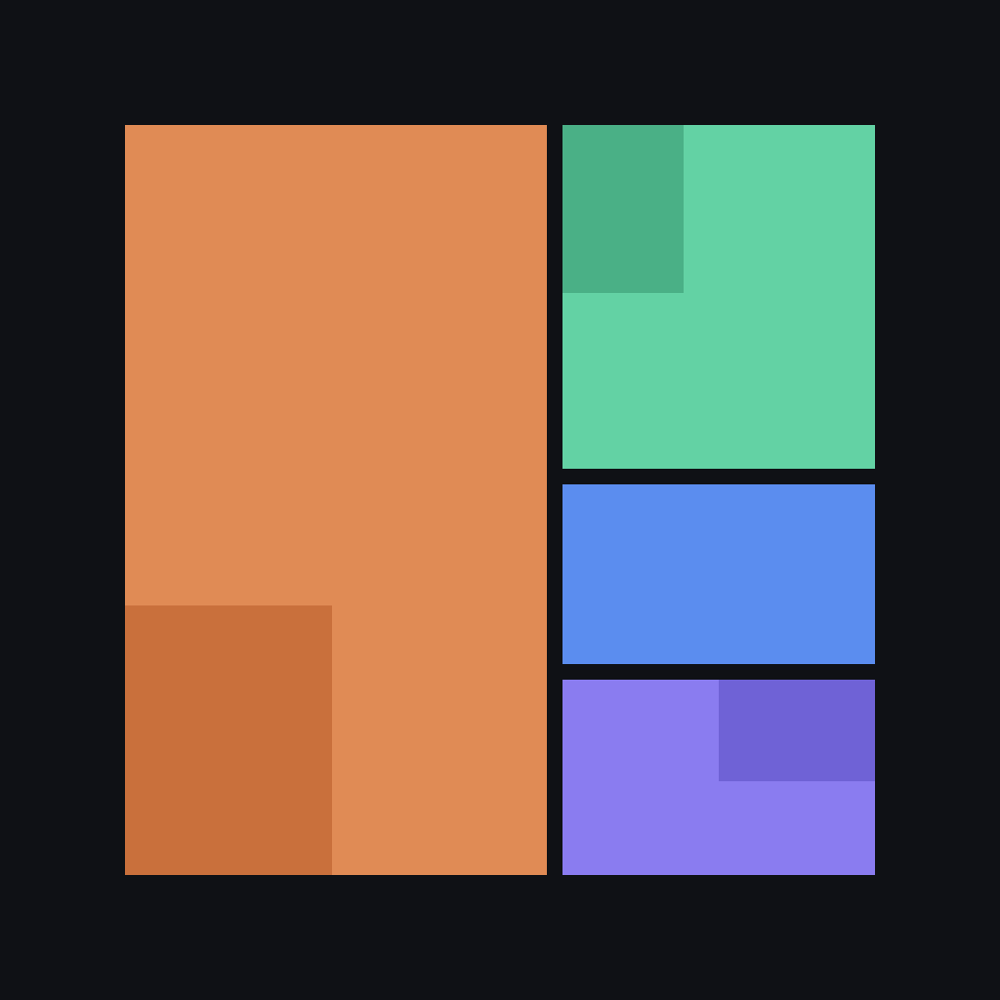

# Sessiontree

A native treemap explorer for the AI coding-agent sessions already on your machine.
Built with [Native Shell](https://nsh.dev) and Rust, it renders local history as a
drill-down map: **agent → project → session**.



## What it reads

Sessiontree is passive: it only reads local stores, never proxies or uploads.

- Claude Code
- Codex
- Cursor
- GitHub Copilot
- OpenCode
- Pi
- DeepSeek Harness
- ZCode
- MiMo Code
- Antigravity (agy)
- Kiro

Sessions are weighted by **tokens**, **cost** or **messages**. Costs use a built-in
price table, including DeepSeek, GLM, MiMo, Qwen and Kimi model ids.

## Install

[Website](https://taokeqin.github.io/sessiontree/) · [Releases](https://github.com/taokeqin/sessiontree/releases)

### macOS / Linux

```sh
curl -fsSL https://taokeqin.github.io/sessiontree/install.sh | sh
```

The installer downloads the latest release, verifies it against `SHA256SUMS.txt`, and
installs `Sessiontree.app` into `~/Applications` (macOS) or `Sessiontree/` into
`~/.local/share` with a `sessiontree` command and desktop entry (Linux). Run it again
to upgrade.

```sh
# A specific release
curl -fsSL https://taokeqin.github.io/sessiontree/install.sh | sh -s -- --version v0.1.0

# Another location (the folder that holds Sessiontree.app / Sessiontree/)
curl -fsSL https://taokeqin.github.io/sessiontree/install.sh | sh -s -- --dir /Applications
```

### Windows

```powershell
irm https://taokeqin.github.io/sessiontree/install.ps1 | iex
```

This installs to `%LOCALAPPDATA%\Sessiontree` and adds a Start menu shortcut. For a
specific release:

```powershell
& ([scriptblock]::Create((irm https://taokeqin.github.io/sessiontree/install.ps1))) -Version v0.1.0
```

Linux needs GTK 4 and GStreamer at runtime, for example on Ubuntu:

```sh
sudo apt install libgtk-4-1 libgstreamer1.0-0 libgstreamer-plugins-base1.0-0
```

### Uninstall

- macOS: delete `~/Applications/Sessiontree.app`
- Linux: delete `~/.local/share/Sessiontree`, `~/.local/bin/sessiontree`, and the
  `com.hacken.sessiontree` desktop/icon files under `~/.local/share`
- Windows: delete `%LOCALAPPDATA%\Sessiontree` and the Sessiontree Start menu shortcut

## Search

The toolbar field searches every agent, project, session title, model id and file path
on the machine. Results stay in the right panel; selecting a project opens its details
with a searchable session list.

## Share screenshots

The toolbar's share button (⇧⌘S / Ctrl+Shift+S) captures the window exactly as shown
and copies it to the clipboard. Before copying, mask:

- agent names
- project names
- session titles
- counts, tokens, cost and dates

The masked labels and numbers are swapped in for the capture and restored immediately
afterwards. Nothing leaves the machine.

## Platforms

| Platform | Status |
| --- | --- |
| macOS 14+ | AppKit, universal arm64 + x86_64 |
| Windows 10 1809+ | Win32, x86_64 |
| Linux (GTK 4.14+) | GTK 4, x86_64 |

Native window capture is implemented on all three; if a platform cannot capture a
window, Sessiontree falls back to a rendered share image.

## Build

```sh
cargo run              # developer build
cargo test             # headless UI + parser tests
nsh package --target macos --arch universal --icon assets/icon.png
nsh package --target linux --icon assets/icon.png
nsh package --target windows --icon assets/icon.png
```

Rust app packaging uses `nsh` 0.6.0. CI uploads macOS, Linux and Windows archives as
artifacts on every `main` push; a `v*` tag publishes those archives to one GitHub
release. The install scripts live on the GitHub Pages site and verify release checksums.

## Privacy

Everything is local. The app reads transcript files and SQLite stores, keeps a metadata
cache in the platform's application-support directory, and writes a screenshot to the
clipboard only when you ask.
