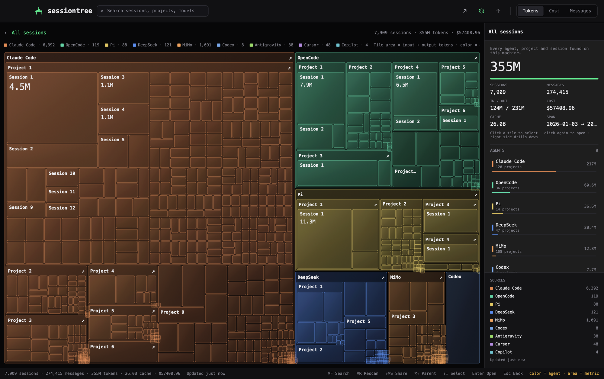

# SessionTree

**Local, cross-platform AI coding usage, from the logs already on your machine.**
SessionTree renders **agent → project → session** as a drill-down treemap. Token counts
come from the agents' own logs, dollar amounts are transparent estimates from a bundled
price table, and nothing is uploaded. Built with [Native Shell](https://nsh.dev) and Rust.



*This window uses SessionTree's share mode: agent, project and session names are replaced
with `Agent N`, `Project N` and `Session N` before the screenshot is copied.*

## Share without leaking your work

Click **Share** in the toolbar (**⇧⌘S** on macOS, **Ctrl+Shift+S** on Windows and Linux).
Agent names, project names and session titles are masked by default; unmask only what you
mean to show. SessionTree can also mask counts, tokens, cost and dates.

- **Copy card** renders a standalone PNG poster: period, the selected metric, the treemap
  and the top agents/projects under the current scope.
- **Copy window** captures the current window as it looks, with the same masks applied.
- **Save report…** writes a Markdown summary, breakdown and top sessions.
- **Save CSV…** writes one row per session for spreadsheets and audits.

The screenshot above used share mode: names are masked, so it is safe to paste into a PR,
an issue or a chat. Nothing is uploaded anywhere.

## Compare agents

The bar-chart button in the toolbar compares every agent side by side: sessions, input,
output, cache, cost, messages and each agent's share of the selected metric. Switch the
metric inside the dialog, or click a row to drill into that agent. Values are masked too
when you share the window.

## Time range and activity

The range chips in the map header filter every agent, project and session by its last
activity: **All**, **7D**, **30D**, **90D**, or a custom start and end date. The range applies
to the treemap, totals, search, compare sheet and share image, and the choice is remembered
between launches. The **Activity** bars in the right panel show the selected metric day by
day over the selected period (the last 30 days for **All**).

## What it reads

SessionTree is passive: it only reads local stores, never proxies or uploads.

- Claude Code
- Codex
- Cursor
- GitHub Copilot
- OpenCode
- Pi
- DeepSeek Harness
- ZCode
- MiMo Code
- Antigravity (agy)
- Kiro

Sessions are weighted by **tokens**, **cost** or **messages**.

### About costs

Token counts are read from each agent's local logs. Dollar amounts are **estimates**:
they use a bundled price snapshot curated from community tables (LiteLLM and models.dev),
so they can differ from what a vendor bills. This is especially true for Cursor, which
exposes local token counts but not its credit and billing math; its cost cell shows `—`
instead of a made-up number.

To override a price, add a `pricing.json` next to `session-index.json` in the app data
directory (`~/Library/Application Support/Sessiontree` on macOS,
`%LOCALAPPDATA%\Sessiontree` on Windows, `~/.local/share/sessiontree` on Linux), or point
`SESSIONTREE_PRICING` at it. The file uses the same shape as
[`assets/pricing.json`](assets/pricing.json); its entries are tried first.

## Install

[GitHub](https://github.com/taokeqin/sessiontree) · [Releases](https://github.com/taokeqin/sessiontree/releases)

### macOS / Linux

```sh
curl -fsSL https://raw.githubusercontent.com/taokeqin/sessiontree/main/install.sh | sh
```

The installer downloads the latest release, verifies it against `SHA256SUMS.txt`, and
installs `Sessiontree.app` into `~/Applications` (macOS) or `Sessiontree/` into
`~/.local/share` with a `sessiontree` command and desktop entry (Linux). Run it again
to upgrade.

```sh
# A specific release
curl -fsSL https://raw.githubusercontent.com/taokeqin/sessiontree/main/install.sh | sh -s -- --version v0.6.0

# Another location (the folder that holds Sessiontree.app / Sessiontree/)
curl -fsSL https://raw.githubusercontent.com/taokeqin/sessiontree/main/install.sh | sh -s -- --dir /Applications
```

### Windows

```powershell
irm https://raw.githubusercontent.com/taokeqin/sessiontree/main/install.ps1 | iex
```

This installs to `%LOCALAPPDATA%\Sessiontree` and adds a Start menu shortcut. For a
specific release:

```powershell
& ([scriptblock]::Create((irm https://raw.githubusercontent.com/taokeqin/sessiontree/main/install.ps1))) -Version v0.6.0
```

Linux needs GTK 4 and GStreamer at runtime, for example on Ubuntu:

```sh
sudo apt install libgtk-4-1 libgstreamer1.0-0 libgstreamer-plugins-base1.0-0
```

### Uninstall

- macOS: delete `~/Applications/Sessiontree.app`
- Linux: delete `~/.local/share/Sessiontree`, `~/.local/bin/sessiontree`, and the
  `com.hacken.sessiontree` desktop/icon files under `~/.local/share`
- Windows: delete `%LOCALAPPDATA%\Sessiontree` and the Sessiontree Start menu shortcut

## Search

The toolbar field searches every agent, project, session title, model id and file path
on the machine. Results stay in the right panel; selecting a project opens its details
with a searchable session list.

## Platforms

| Platform | Status |
| --- | --- |
| macOS 14+ | AppKit, universal arm64 + x86_64 |
| Windows 10 1809+ | Win32, x86_64 |
| Linux (GTK 4.14+) | GTK 4, x86_64 |

Native window capture is implemented on all three; if a platform cannot capture a
window, SessionTree falls back to a rendered share image.

## Build

```sh
cargo run              # developer build
cargo test             # headless UI + parser tests
nsh package --target macos --arch universal --icon assets/icon.png
nsh package --target linux --icon assets/icon.png
nsh package --target windows --icon assets/icon.png
```

Rust app packaging uses `nsh` 0.6.0. CI uploads macOS, Linux and Windows archives as
artifacts on every `main` push; a `v*` tag publishes those archives to one GitHub
release. The install scripts are served from `raw.githubusercontent.com` and verify release
checksums.

## Languages

SessionTree follows the system language and ships English, 简体中文 and 日本語. Pick
another one from the language menu (the globe button) in the toolbar; the choice is
remembered. Set `SESSIONTREE_LANG=en`, `zh` or `ja` to override it on launch.

## Privacy

Everything is local. The app reads transcript files and SQLite stores, keeps a metadata
cache in the platform's application-support directory, and writes a screenshot to the
clipboard only when you ask.

## License

[MIT](LICENSE)
